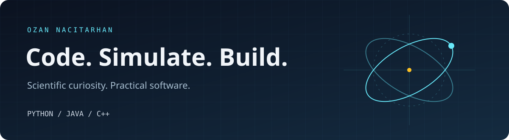

  

<h1 align="center">Özgün Ozan Nacitarhan</h1>

<b>Quantum physics · AI experiments · Software engineering · Robotics</b>

<a href="https://www.linkedin.com/in/oozann/">LinkedIn</a> · <a href="https://doi.org/10.1109/EMBC48229.2022.9871174">PySio publication</a>

I like problems where physics meets code: making a model visible, turning an algorithm into a useful tool, or connecting software to a robot.

My academic background spans **Computer Engineering and Physics at Koç University** and **Quantum Science & Technology at TUM and LMU**. My research experience includes quantum optics and photonics, quantum communication, physiological signal analysis, and computational biology.

### A little about me

- **Quantum research:** work with groups in Munich and Berlin, including Max Planck Institute of Quantum Optics and Humboldt University of Berlin, including Bohmian trajectories, a BB84 quantum-key-distribution setup, and optical characterization of quantum emitters.
- **Software engineering:** experience at IBM and Siemens, alongside teaching-assistant work in Python and Java at Koç University.
- **Robotics & teaching:** mentoring Inanç Mechatronics / FRC Team 4191, FIRST volunteering, and teaching Python and robotics.
- **AI interests:** automatic differentiation, learning algorithms, information retrieval, and quantum-inspired feature maps.

### Languages & tools

  
  
  
  
  
  
  

### Earlier public work

| Project | Focus |
| :--- | :--- |
| **[Feynman's Wobbling Plate](https://github.com/oonacitarhan/Feynmans-Wobbling-Plate)** | A Python / VPython visualization of a spinning plate, with axis markers and time-dependent plots. |
| **[Quantum Information Calculations](https://github.com/oonacitarhan/PHYS450-HW2)** | Python / QuTiP coursework on coherence, correlations, entanglement of formation, and negativity. |

### AI, quantum & robotics demo lab

#### AI & learning

| Project | Language | Explore |
| :--- | :--- | :--- |
| [Scalar Autograd Lab](https://github.com/oonacitarhan/scalar-autograd-lab) | Python | Scalar reverse-mode differentiation, a multilayer perceptron, finite-difference checks, and XOR training. |
| [Lexical Retrieval Lab](https://github.com/oonacitarhan/lexical-retrieval-lab) | Python | BM25 passage ranking, overlapping chunks, corpus persistence, and MRR/recall evaluation. |
| [Bandit Policy Bench](https://github.com/oonacitarhan/bandit-policy-bench) | Python | Epsilon-greedy, UCB1, Thompson sampling, repeated seeded trials, and uncertainty summaries. |
| [Quantum Kernel Sketch](https://github.com/oonacitarhan/quantum-kernel-sketch) | Python | A product-state fidelity kernel, trainable kernel perceptron, and held-out baseline comparison. |

#### Quantum physics & algorithms

| Project | Language | Explore |
| :--- | :--- | :--- |
| [Qubit State Lab](https://github.com/oonacitarhan/qubit-state-lab) | Python | JSON-defined circuits, statevectors, Hadamard/X/RY/CX gates, Z observables, and seeded shot sampling. |
| [Ising Exact](https://github.com/oonacitarhan/ising-exact-cpp) | C++ | Field-dependent Ising-chain thermodynamics, fluctuation observables, temperature sweeps, and CMake builds. |
| [A-Star Grid](https://github.com/oonacitarhan/astar-grid-cpp) | C++ | Reusable grid planning, map-file input, route validation, and uniform-cost cross-checks on seeded grids. |
| [Experiment Queue](https://github.com/oonacitarhan/experiment-queue-java) | Java | Job-file input, dependency-aware priority order, cycle detection, and critical-path timing. |

#### Robotics

| Project | Language | Explore |
| :--- | :--- | :--- |
| [PID Control Playground](https://github.com/oonacitarhan/pid-control-playground) | Python | Motor-plant simulation, anti-windup, disturbance injection, tracking metrics, and CSV trace export. |
| [Differential Drive Odometry](https://github.com/oonacitarhan/differential-drive-odometry) | C++ | Calibrated encoder-log replay, constant-curvature pose integration, and trajectory regression checks. |
| [Robot Command Scheduler](https://github.com/oonacitarhan/robot-command-scheduler) | Java | Timed commands, sequences, subsystem ownership, deferred callback scheduling, and lifecycle traces. |

The collection has **200 commits across 11 multi-file projects** as of 2026-11-01. Local source builds, regression checks, and documented CLI examples pass. These remain inspectable learning projects. Robotics examples run in simulation and are independent of my team work; quantum examples make no claim of quantum advantage.

### Research writing

- **PySio: A New Python Toolbox for Physiological Signal Visualization and Feature Analysis** — Özgün Ozan Nacitarhan and Beren Semiz, EMBC 2022. [Paper](https://doi.org/10.1109/EMBC48229.2022.9871174)
- **SUPER and femtosecond spin-conserving coherent excitation of a tin-vacancy color center in diamond** — coauthor, Nature Communications 17, 2154 (2026). [Paper](https://doi.org/10.1038/s41467-026-69911-1) · [arXiv](https://arxiv.org/abs/2312.05246)
